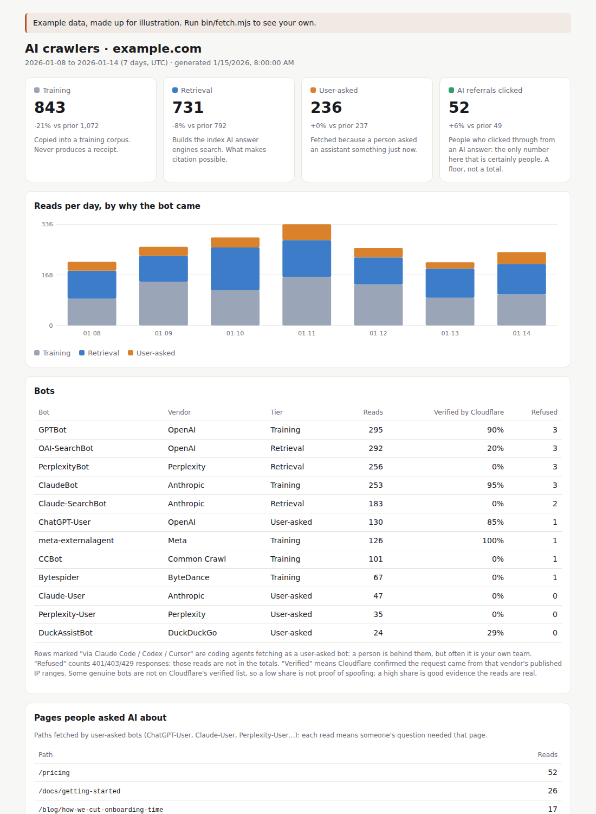

# AI crawler analytics

See which AI crawlers read your website, and **why**: copying it for training, indexing it for AI
search, or fetching it because a person just asked ChatGPT, Claude or Perplexity something that
needed your page. Built on the Cloudflare analytics you already have, with the noise taken out.



*(Example data. Yours comes from your own Cloudflare zone.)*

## Why not just count "AI bots"?

Because one number mixes up three very different things. Each AI company runs several bots:

| Tier | What it means | Examples |
|---|---|---|
| **Training** | Copies pages into a training corpus. You never get a receipt, and you can't tell if a model used it. | GPTBot, ClaudeBot, meta-externalagent, CCBot, Bytespider, Amazonbot |
| **Retrieval** | Builds the search index AI answer engines look things up in. What makes being cited possible. | OAI-SearchBot, Claude-SearchBot, PerplexityBot, Amzn-SearchBot |
| **User-asked** | Fetched because a person asked an assistant something just now. The only crawler signal of real demand. | ChatGPT-User, Claude-User, Perplexity-User, DuckAssistBot, MistralAI-User |

And one thing that is not a crawler at all: **AI referrals**, people who clicked a link in an AI
answer and landed on your site. That is the only number here that is certainly people.

The full list, with each vendor's documentation, is in [`data/ai-crawlers.json`](data/ai-crawlers.json).

## What is in the box

| Path | What it is |
|---|---|
| `data/ai-crawlers.json` | User agent → bot → tier, with sources. Edit it or send a PR when vendors add bots. |
| `data/ai-referrers.json` | AI assistant hosts and `utm_source` values for counting click-throughs. |
| `bin/fetch.mjs` | Pulls your zone's data with a read-only token and writes `dashboard/data.json`. Node 18+, no dependencies. |
| `dashboard/index.html` | A single static page that draws the dashboard from that file. No build, no tracking, no CDN. |
| `worker/` | Optional Cloudflare Worker: keeps history beyond Cloudflare's retention, counts AI referrals, serves the dashboard. |
| `dashboard/referral.js` | Optional 1 KB script that reports a visit only when it came from an AI assistant. |
| `skill/SKILL.md` | A Claude skill: Claude fetches the data and builds the dashboard as an Artifact for you. |

## Quick start (5 minutes)

### 1. Make a read-only Cloudflare API token

Cloudflare dashboard → **My Profile → API Tokens → Create Token → Create Custom Token**:

- **Permissions:** `Zone` → `Analytics` → `Read`. Add `Zone` → `Zone` → `Read` if you want to pass your domain name instead of the zone id.
- **Zone Resources:** `Include` → `Specific zone` → your domain.
- Optional: **Client IP Address Filtering** to the machine you will run it from.

That token can read your analytics and nothing else. Do not use a Global API Key.

### 2. Fetch your data

```bash
git clone https://github.com/StovBuilds/ai-crawler-analytics && cd ai-crawler-analytics
CF_API_TOKEN=your-token node bin/fetch.mjs --zone example.com --days 7 --sitemap auto
```

Useful options:

- `--sitemap auto|<url>`: count only pages in your sitemap (recommended; see "What we exclude"). `auto` reads `/sitemap.xml` and every `Sitemap:` line in your robots.txt.
- `--exclude-ip 203.0.113.7,...`: your own servers or office.
- `--exclude-ua my-monitor`: a tag your own uptime checks or audit tools put in their user agent.
- `--zone-id <id>`: skip the zone lookup (then the token needs only Analytics Read).

### 3. Open the dashboard

```bash
npm run dashboard        # then open http://localhost:8787
```

Or open `dashboard/index.html` and drop the JSON file onto it. `?demo` shows the example data.

## Use it from Claude

**Claude Code:** copy `skill/` into `~/.claude/skills/ai-crawler-analytics/` (or your project's
`.claude/skills/`), then ask *"show me which AI crawlers read example.com"*. Claude asks for the
read-only token, runs the fetch, and builds the dashboard.

**claude.ai:** add the skill (Settings → Capabilities → Skills: zip the `skill/` folder and upload it) or paste it
into a Project's instructions. Run step 2 on your machine, paste the JSON into the chat, and ask for the
dashboard: Claude builds it as an Artifact. No shell? [`docs/manual-query.md`](docs/manual-query.md) has
the raw query to run with curl or Cloudflare's GraphQL explorer.

Either way, the token never needs to leave your machine if you paste the JSON instead.

## Keep history and count AI referrals (optional Worker)

Cloudflare keeps this detailed data for about two weeks on the Free plan, and the Free plan has no
referrer data. The Worker fixes both:

```bash
cd worker
cp wrangler.toml.example wrangler.toml          # fill in ZONE_ID, ZONE_NAME, SITEMAP_URL
npx wrangler kv namespace create STORE           # paste the id into wrangler.toml
npx wrangler secret put CF_API_TOKEN             # the read-only token from step 1
npx wrangler secret put DASH_KEY                 # optional: then open the dashboard with ?key=...
npx wrangler deploy
```

It collects yesterday (and fills any gap in the last 14 days) once a day into KV, and serves the
dashboard at its URL. To count AI referrals, add this to your pages:

```html
<script src="https://your-worker.workers.dev/referral.js" data-endpoint="https://your-worker.workers.dev/r" defer></script>
```

(the Worker serves `dashboard/referral.js`; you can also host the file yourself). It sends nothing at all
unless the visit came from an AI assistant, sets no cookies, and the Worker stores only a per-day count
per assistant: no IP address, no page, no identifier.

On a Pro plan or higher, the fetcher also reads referrers straight from Cloudflare, no script needed.

## What we exclude, and why

These rules came from running this on our own sites, where the raw numbers were badly wrong:

1. **Scanners wearing AI user agents.** Anyone can type "ChatGPT-User" into a user agent. Vulnerability
   scanners do, while walking `/.env`, `/.git/config`, `/wp-login.php`, `railway.toml`,
   `docker-compose.yml`, `/proc/self/environ` and hundreds more. On our sites they were about a fifth of
   all "AI crawler" requests and most of the user-asked tier on one site. Excluded by path
   (`PROBE_PATH_RE` in `src/classify.js`) and counted separately.
2. **Anything that wasn't a real page served.** A read counts only if it got a 2xx/3xx. 404s and errors
   are excluded (scanners mostly ask for files that don't exist). With `--sitemap`, paths not in your
   sitemap are excluded too (robots.txt and llms.txt are always allowed).
3. **Refusals are reported, not counted.** 401/403/429 responses show per bot as "Refused": a crawler
   you are blocking has not read anything.
4. **Your own traffic.** Your uptime checks, SEO audits and AI-visibility tools fetch your site with real
   crawler user agents. Exclude them with `--exclude-ip` / `--exclude-ua`. On our sites one audit run was
   98% of a day's rows.
5. **Clockwork readers.** A user-asked bot fetching the same page every day, once or twice a day, is a
   monitor or someone's scheduled agent, not people asking questions (we saw Perplexity-User read one
   homepage exactly once a day). Flagged on the dashboard and shown separately.
6. **Coding agents.** Claude Code and similar tools fetch pages as user-asked bots. There is a person
   behind them, but often it is your own team. Shown as separate rows ("Claude-User via Claude Code").
7. **Everything that isn't an AI crawler.** Humans, search engines, SEO tools and other bots are not in
   these numbers. In particular, Cloudflare's "unique visitors" is mostly bots on a site that invites
   crawlers; don't read it as people.

## Limits (read these before quoting a number)

- **Sampled.** Cloudflare's adaptive analytics are sampled estimates. Read small numbers as
  present / absent, not exact volume.
- **User agents can be forged.** The "Verified by Cloudflare" column shows how many reads came from the
  vendor's published IP ranges. Not every genuine bot is on Cloudflare's verified list (on our sites,
  several real ones weren't), so a low share is not proof of fakes; a high share is good evidence of real ones.
- **A missing bot is not a blocked bot**, and a training read never tells you whether a model used the
  page.
- **Google-Extended and Applebot-Extended** are robots.txt switches, not crawlers. Google and Apple
  fetch with Googlebot / Applebot, so those reads can't be separated and never appear here.
- **AI referrals are a floor.** Browsers and apps strip referrers. ChatGPT adds `utm_source=chatgpt.com`,
  which survives; the tracker counts a click once even when both are present.
- **Retention.** About two weeks of detail on the Free plan. Run the Worker if you want trends.
- **10,000 rows per day per query.** Very busy sites can hit it; the dashboard flags truncated days.
- **Custom hostnames.** If your domain is actually served through another company's Cloudflare
  account (some site builders do this), its traffic does not appear in your zone's analytics.

## Check you aren't blocking them by accident

Cloudflare can block AI crawlers by default, from two separate switches under **Security → Bots**:
"Block AI bots" (crawlers get a bare 403) and "Instruct bot traffic with robots.txt" (Cloudflare serves
its own robots.txt instead of yours). Test with the real user agents:

```bash
for ua in "GPTBot/1.0" "OAI-SearchBot/1.0" "ChatGPT-User/1.0" "ClaudeBot/1.0" "Claude-SearchBot/1.0" "PerplexityBot/1.0" "Mozilla/5.0"; do
  printf '%-20s %s\n' "$ua" "$(curl -s -o /dev/null -w '%{http_code}' -A "$ua" https://example.com/)"
done
```

Browsers getting 200 while the AI bots get 403 means the switch is on. Remember that each bot needs its
own robots.txt line: blocking `ClaudeBot` does not block `Claude-SearchBot` or `Claude-User`.

## Privacy

- The fetcher only reads aggregated analytics from your own Cloudflare account. Nothing is sent anywhere
  else.
- The dashboard is a static file with no third-party requests.
- The referral tracker sends one beacon only for AI-referred visits and stores no personal data.

## Tests

```bash
npm test
```

## Contributing

New bots appear every few months. Add them to `data/ai-crawlers.json` with a link to the vendor's
documentation and a test case in `test/classify.test.mjs`. Same for scanner paths in `src/classify.js`.

## Licence

MIT. Built by [Adapt Progress Evolve](https://adaptprogressevolve.com), from the analytics we run on
our own sites.
